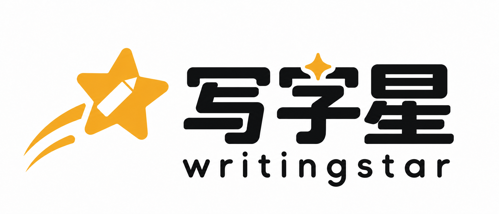

# 写字星正式品牌素材

用户于2026-10-16确认以下两张 Logo 作为后续开发使用的品牌素材。

| 文件 | 用途 | 原图 |
| --- | --- | --- |
| [writingstar-logo-horizontal.png](writingstar-logo-horizontal.png) | 页面页头、登录页、文档等横向品牌展示；含中文和英文 | 铅笔镂空流星横版，原始生成编号 exec-10b99098-b98d-42e7-b46b-1d12e1594783 |
| [writingstar-logo-app.png](writingstar-logo-app.png) | 微信小程序、App、圆形头像展示；上图下字，仅中文 | 圆形裁切安全留白方形版，原始生成编号 exec-bddaebae-f5c1-4cb5-89c2-3326ad2bddaa |

## 使用约定

- 后续新增或替换品牌展示统一使用以上文件，不使用早期 WS 融合草稿或其他历史 Logo。
- 保持原始长宽比，使用等比缩放（如 `mode="aspectFit"` / `object-fit: contain`），不拉伸、不压扁。
- 图标版保留原有白色留白，圆形展示由容器裁切，避免进一步放大裁掉文字和流星尾迹。
- 当前为白底 PNG 原图，铅笔镂空为白色留白；矢量、透明底和平台各尺寸图标可在后续基于此版本制作。
- 本次收录确立品牌素材，不代表已完成各业务页面的 Logo 替换或微信平台图标配置。

